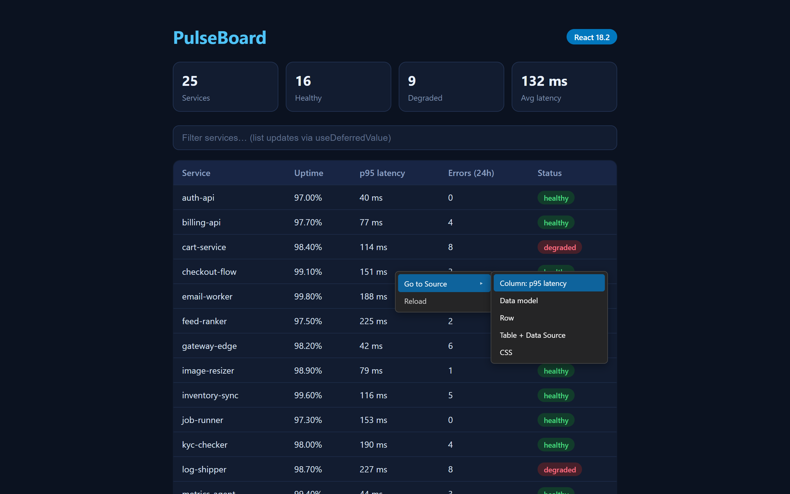
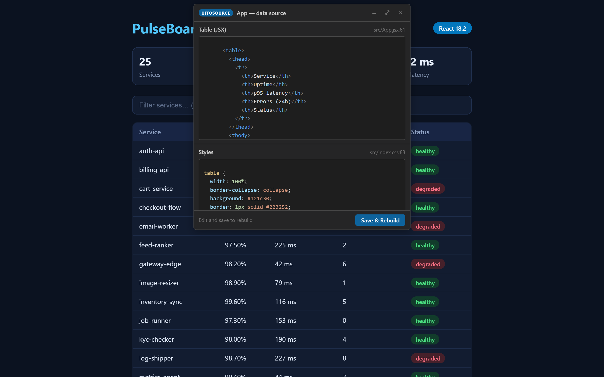

# UIToSource

**Click an element in your running React or Angular app — jump to its source, or edit it in place.**

UIToSource runs your project's dev server behind a local proxy, overlays a
right-click menu on the live app in a browser tab, and resolves what you click
back to the exact TypeScript, template/JSX, and CSS that produced it. Edits
made in the trace popup are saved straight into your workspace files
(drift-guarded and undoable), and your dev server hot-reloads them.

➡️ **Install from the [Visual Studio Marketplace](https://marketplace.visualstudio.com/items?itemName=uitosource.uitosource)**
· also on [Open VSX](https://open-vsx.org/extension/uitosource/uitosource)

## Requirements

- VS Code 1.93+ and Node 20.6+
- A **React (16–19) or Angular (12+)** project running on its **dev server**
  (production/minified builds get a best-effort element trace only)

Everything runs locally: no telemetry, nothing leaves your machine. See the
extension's Marketplace page for the full feature list, configuration
(`uitosource-config.json`), troubleshooting, and the security model.

## Issues & support

**This is the public home of UIToSource** — bug reports and feature requests
are very welcome in the [issue tracker](https://github.com/uitosource/uitosource/issues).
The extension's source is developed in a private repository; this repo hosts
the project's public face (docs, listing assets, and issues).

When filing a bug, please include:

1. Your framework + version (e.g. Angular 15, React 18.2) and build tool
   (Vite / webpack / Angular CLI / Next.js)
2. What you right-clicked and which menu item you chose
3. The matching lines from **Output → UIToSource** in VS Code — especially the
   `[trace] outcome=…` line, which names exactly where the trace stopped

## License

[MIT](LICENSE). Bundled third-party notices ship inside the extension package
(`THIRD_PARTY_NOTICES.md`).
